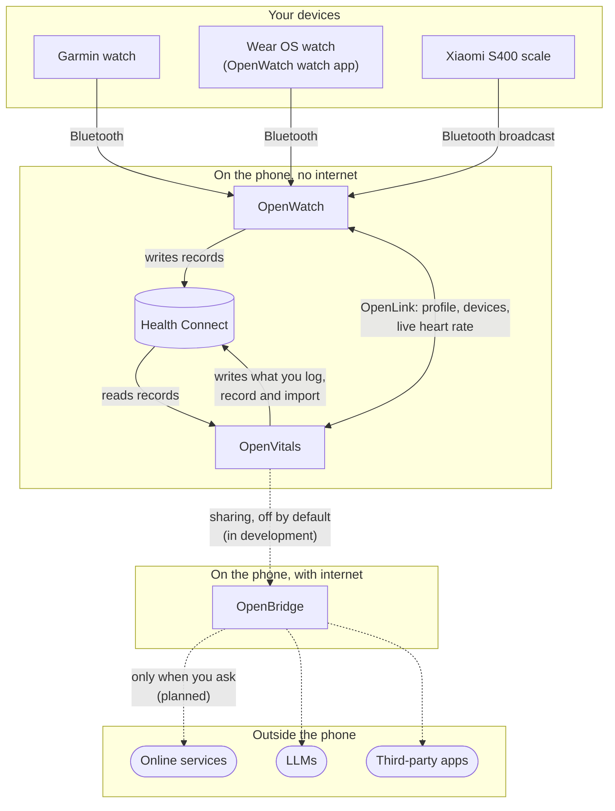

# Architecture

Hale publishes three apps and the link between two of them. They are built around one rule: **your health data stays on the phone, and leaves it only through something you start yourself.**

Solid lines work today. Dashed lines are being built: see [Status](#status).

## Offline By Default

OpenWatch and OpenVitals declare **no internet permission**, and their manifests strip it from every library they include, so Android itself stops them from reaching the network. That is a property of the installed app anyone can check, not a promise in a policy.

OpenBridge is the only app with internet access. It is separate and optional: without it, nothing in the family can send anything anywhere.

## The Pieces

### Health Connect

Android's on-device store for health records, and the hub everything else meets at. Each app asks for each record type separately (read steps, write weight, and so on), and you grant or revoke each one in Health Connect's settings. Every record remembers which app wrote it, and only that app can change or delete it. Records stay in Health Connect when an app is uninstalled.

### OpenWatch, the devices

[OpenWatch](openwatch/index.md) talks to the hardware and writes what it records to Health Connect:

- a **Garmin watch** over Garmin's own Bluetooth protocol: activities with their routes, sleep, steps, heart rate, HRV, SpO2, VO2 max and more;
- a **Wear OS watch** through the OpenWatch watch app, over Bluetooth: heart rate, steps, floors, and an estimated night of sleep;
- a **Xiaomi S400 scale**, by listening for the weigh-in it broadcasts and decoding it with the key from your Xiaomi account.

What Health Connect has no record type for (a Garmin's stress, Body Battery, sleep score) stays in OpenWatch's own storage on the phone.

### OpenVitals, the dashboard

[OpenVitals](openvitals/index.md) reads your Health Connect records, from OpenWatch and any other app, and turns them into a daily view: metrics, sleep, readiness, trends. It writes to Health Connect only through something you start: an entry you save, an activity you record, an import you run. It can also sync with a second phone you pair over Bluetooth.

### OpenLink, between the two

[OpenLink](openlink/index.md) carries what Health Connect has no place for, inside the phone: the body profile both apps need, the state of your watches for OpenVitals' dashboard tile, and a watch's live heart rate while OpenVitals records an activity. It never carries health records. OpenWatch decides what each app may do, on its [Connected apps](openwatch/connected-apps.md) screen.

### OpenBridge, the way out

[OpenBridge](openbridge/index.md) is the one app that can reach the internet, so that the others never need to. It is meant to read the data OpenVitals chooses to share, group by group and only once you switch sharing on, and pass it on to the services you pick: online services, language models, other apps.

## How Data Moves

| From | To | Over | Who decides |
| --- | --- | --- | --- |
| Watch or scale | OpenWatch | Bluetooth | You, by pairing the device |
| OpenWatch | Health Connect | Android's Health Connect API | You, per record type, in Health Connect |
| Health Connect | OpenVitals | Android's Health Connect API | You, per record type, in Health Connect |
| OpenVitals | Health Connect | Android's Health Connect API | You, by saving, recording or importing |
| OpenWatch | OpenVitals, and back | OpenLink, inside the phone | OpenWatch's Connected apps screen |
| OpenVitals | OpenBridge | A sharing interface, inside the phone | You: off by default, Android's permission per group |
| OpenBridge | The internet | The network | You, per service, when you ask |

## Status

- **Working:** OpenWatch, OpenVitals, Health Connect between them, and OpenLink.
- **In development:** the sharing interface from OpenVitals to OpenBridge. It is not in an OpenVitals release yet.
- **Planned:** OpenBridge's connections to online services, language models and other apps. None is connected yet.

The source of each piece: [OpenVitals](https://github.com/Hale-MTU/OpenVitals), [OpenWatch](https://github.com/Hale-MTU/OpenWatch), [OpenLink](https://github.com/Hale-MTU/OpenLink), [OpenBridge](https://github.com/Hale-MTU/OpenBridge).
